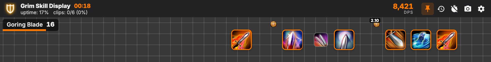
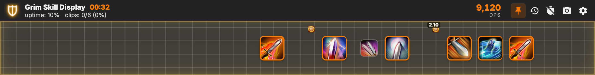
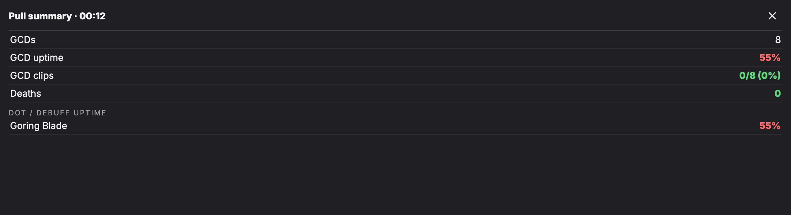
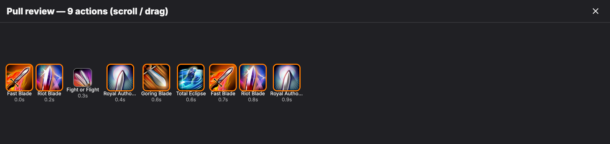
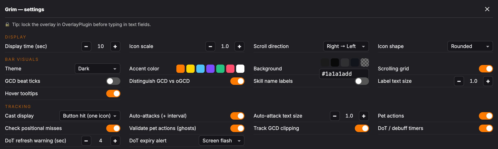

# Grim Skill Display

A FFXIV skill-rotation overlay for **Advanced Combat Tracker (ACT)** + **OverlayPlugin**. Your
skills scroll across a music-bar timeline as you cast them — a modern, self-contained, and
feature-rich replacement for the unmaintained *Kagami* overlay.



> **Why this exists:** Kagami fetched every icon live from the old XIVAPI and shipped a skill
> list frozen at patch 7.0, so anything added since showed up as `??` with no icon. Grim
> **bundles every icon and the full current skill list inside the repo**, so it never breaks
> when an external service goes down — and a single re-runnable script re-syncs it after each
> patch. Every job through **Beastmaster** (7.56) is covered, and new jobs need no code change.

---

## Quick start

You need [ACT](https://advancedcombattracker.com/download.php), the
[FFXIV ACT Plugin](https://github.com/ravahn/FFXIV_ACT_Plugin/releases/latest), and
[OverlayPlugin (ngld)](https://github.com/ngld/OverlayPlugin/releases/latest) already installed
and working.

1. In ACT, open **Plugins → OverlayPlugin.dll**.
2. Click **New**. Set **Preset = Custom**, **Type = MiniParse**, give it a name like `Grim`, and
   click **OK**.
3. Select the new overlay in the list on the left, and set the **URL** to:

   ```
   https://jfinsmith.github.io/Grim-Skill-Display/
   ```

4. Click **Reload**. The bar appears — hit a striking dummy and your skills scroll across it.
5. Click the **⚙ gear** for settings (a full-window panel with tabs; make the overlay window
   bigger if it feels cramped). Drag the bar to move it, drag the bottom-right corner to resize,
   then **lock the overlay** (right-click it in OverlayPlugin → *Lock*) when you're happy.

### Centering the bar on screen

OverlayPlugin doesn't let a page move its own window, so Grim does it the other way round:
stretch the overlay window across the **whole width of your screen**, then click the
**⇔ center** button in the header (or set *Layout → Bar width* to ~60% and *Bar position* to
*Center*). The bar draws in the middle of the window, which is the middle of your screen; the
rest of the window is transparent. Click the button again for full width.

### Locking

The **🔒 lock** button freezes Grim's own layout controls (bar width / position, resize corner).
The window's position and size can only be locked by OverlayPlugin itself: right-click the
overlay → **Lock**, or tick *Lock overlay* in its config. Do both.

> **Updated and still seeing the old overlay?** OverlayPlugin's browser caches hard. Change the
> URL to `https://jfinsmith.github.io/Grim-Skill-Display/?v=2` (any new query string works) and
> Reload — that forces a fresh download.

> **Tip:** keep the header **pinned** (📌, the default) if you use a transparent background — a
> fully transparent bar is otherwise click-through and the header only appears when you hover an
> icon.

### Use in OBS

Start **OverlayPlugin → WSServer**, copy the generated overlay URL, and add it as a **Browser
Source** in OBS. Right-click the source → **Interact** to change settings (OBS browser sources
don't share ACT's settings; each one stores its own).

---

## Features

### The bar


- **Music-bar timeline** of your skills and pet skills. Skills pop in, cross the bar, and **fade
  out** at the far edge. Scroll **right→left** or **left→right**.
- **GCD vs oGCD distinction** — GCDs are larger with an accent border; oGCDs are smaller and layer
  on top — so weaves and your rotation's rhythm are readable at a glance.
- **Auto-attack lane** with the time between each auto-attack, so you can eyeball your effective
  attack/skill speed.
- **Cast bars**, interrupt markers (a hard-cast that gets cut shows a red ✖), and **consumable**
  (pot/tincture) and **mount** icons.
- **Live mini-meter** (top-right) — click it to cycle **Personal DPS → Healing/s → Damage taken/s
  → Raid DPS**.
- **GCD uptime %**, **clip %**, and **positional-miss %** live in the header.

### Burst-window highlight



The bar **pulses gold** while a party damage-up buff is on you (Divination, Brotherhood, Embolden,
Searing Light, Battle Litany, Technical Finish, and more) so you can see exactly what you fit into
your burst. The buff list lives in [`resources/data/raidbuffs.json`](resources/data/raidbuffs.json)
and is easy to edit. Toggle: **Highlight raid-buff windows**.

### DoT / debuff tracker

Live countdown pips (top-left) for every DoT and damage-debuff you apply — they fill a bar, turn
**red and flash** when about to expire, and can optionally trigger a **screen flash or beep**. It's
detected straight from the combat log, so it works for **every job automatically** with no per-job
setup.

### Pull summary



When combat ends, a card breaks down the pull: GCDs, **GCD uptime %**, clips, positional misses,
pet ghosts, deaths, and **per-DoT uptime %** — color-coded so problems jump out.

### Pause & review



Click the **⟲ history** button to freeze and scroll back through **every skill you pressed** in the
pull, with timestamps. Drag or scroll the strip.

### More

- **Death & downtime markers** on the timeline.
- **Opener countdown** — a big 5→1 synced to the in-game `/countdown`.
- **Rotation snapshot** — save the last ~15 seconds of the bar as a PNG to share.

### Settings



Everything is configurable from the in-overlay settings modal, grouped into **Layout · Look ·
Tracking · DoTs & buffs · Analysis**, with a one-line explanation under every setting: bar
width/position/lock, themes (dark / light / job-color), accent + background color, icon shape and
scale, display time, scroll direction, labels, every tracker and analysis feature, and the meter
metric.

> All controls are click-based (toggles, steppers, segmented buttons, color swatches) because
> OverlayPlugin's embedded browser doesn't handle native dropdowns or sliders well. To type in the
> **hex background field**, lock the overlay first.

---

## Updating after a game patch

Icons and skill data are bundled, so Grim keeps working through patches. When a patch adds new
skills (or a new job), re-sync the data with the one script in `tools/` — plain Windows
PowerShell, nothing to install:

```powershell
powershell -NoProfile -ExecutionPolicy Bypass -File tools/resync.ps1

git add resources; git commit -m "Resync data for patch X.Y"; git push
```

It rebuilds the skill / item / mount / general-action tables, downloads only the icons that
aren't on disk yet, fetches a job icon for any new job, and writes `resources/data/meta.json`
(the game version shown in the settings footer). Positionals are read from each skill's own
description, so a reworked or brand-new rear/flank skill is picked up automatically.

Data comes from [XIVAPI v2](https://v2.xivapi.com/). All FFXIV content is © SQUARE ENIX.

---

## Project layout

```
index.html               entry point (loads the modules + OverlayPlugin bridge)
src/                      ES modules — no build step
  app.js                   orchestrator / startup
  act.js                   ACT · OverlayPlugin · WebSocket listener
  parser.js                interprets battle-log lines, drives every feature
  bar.js                   the scrolling skill bar
  meter.js                 live DPS/HPS/DT/rDPS meter
  dots.js                  DoT / debuff tracker
  rotation.js              positional + GCD-clip + uptime analysis
  features.js              raid-buff glow, markers, countdown, summary, alerts
  review.js                pause & scrollback
  header.js  settings-ui.js  tooltip.js  snapshot.js  store.js  data.js  lang.js
resources/
  data/*.json              actions, items, mounts, jobs, raid buffs, language, settings, meta
  icons/*.png              ~2,800 bundled HD icons (skills, items, mounts)
  classjob/<ABBR>.png      one icon per job (PLD.png, BST.png, ...); hidden until ACT reports a job
tools/resync.ps1           data-regeneration script (PowerShell; not shipped to users)
docs/img/                  screenshots used in this README
```

No bundler, no build step — it's plain HTML/CSS/ES-modules served straight from GitHub Pages.
For hacking on it locally, `window.grim.handleEvent(...)` in the browser console feeds the
overlay a synthetic ACT event.

---

## Notes & limitations

- **Raid-buff highlight** and the **opener countdown** match by English text, so on non-English
  clients you'll want to add the localized status / system-message names (see the comment in
  `raidbuffs.json`).
- An overlay page **cannot move, resize or lock its own window**, and cannot open a separate
  window — OverlayPlugin exposes no API for it. That's why centering works via bar width and why
  settings live inside the overlay.
- **Positional detection** covers every rear/flank skill in the data (MNK / DRG / NIN / SAM / RPR
  / VPR). Whether the bonus landed is read from the action-effect entries in the log line, which
  is a heuristic inherited from Kagami — if a positional looks wrong, see `checkPositional` in
  `src/rotation.js`.
- **Downtime markers** are an approximation (long gaps between GCDs) — turn them off if they're
  noisy for your content.

---

## Credits

- Original concept and much of the battle-log handling: **Kagami** by *ram*, fork by *sgosiaco*
  (MIT). Grim is an independent modernization and expansion.
- Game data & icons via **XIVAPI v2**. All FINAL FANTASY XIV content is property of **SQUARE ENIX
  CO., LTD.**

Released under the **MIT License** — see [LICENSE](LICENSE).
